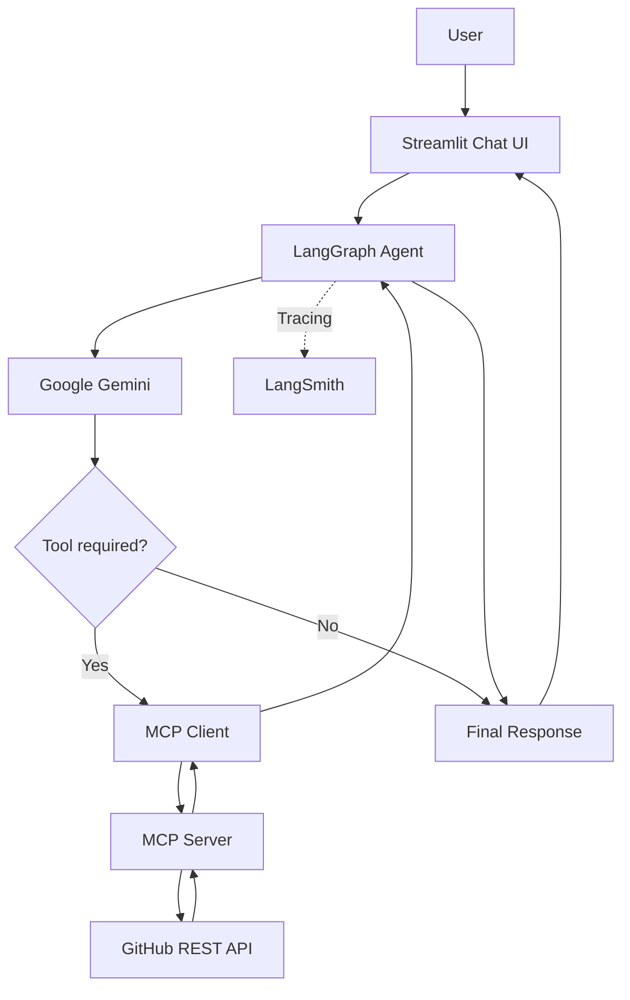

# GitHub MCP AI Assistant

An AI-powered GitHub assistant built with **Model Context Protocol (MCP)**, **Google Gemini**, **LangGraph**, and **Streamlit**.

The application allows users to interact with GitHub repositories using natural language. Gemini analyzes user requests, selects the appropriate MCP tools, and retrieves information from GitHub through the GitHub REST API.

## 1. Overview

GitHub MCP AI Assistant demonstrates how to integrate MCP with an LLM-powered agent.

Instead of manually navigating GitHub or writing API requests, users can ask questions such as:

- Show me all public repositories of a GitHub user.
- Get details about a specific repository.
- List open issues in a repository.
- Show pull requests.
- Find recent commits.
- Read files from a repository.

The AI agent determines which tools are needed and executes them through the MCP protocol.

## 2. Architecture



### Main components

| Component       | Responsibility                               |
| --------------- | -------------------------------------------- |
| Streamlit       | Provides the chat interface                  |
| Google Gemini   | Understands user requests and selects tools  |
| LangGraph       | Controls the agent execution workflow        |
| MCP Client      | Connects to the MCP Server and invokes tools |
| MCP Server      | Exposes GitHub functionality as MCP tools    |
| GitHub REST API | Provides repository information              |
| LangSmith       | Tracks and monitors agent execution          |

## 3. Features

### GitHub MCP Tools

The MCP Server currently provides the following tools:

| Tool                       | Description                                |
| -------------------------- | ------------------------------------------ |
| `list_public_repositories` | Lists public repositories of a GitHub user |
| `get_repository`           | Retrieves repository details               |
| `list_issues`              | Lists repository issues                    |
| `list_pull_requests`       | Lists pull requests                        |
| `list_commits`             | Retrieves repository commits               |
| `get_file_contents`        | Reads files from a repository              |

### AI Agent

- Natural-language interaction with GitHub.
- Automatic tool selection using Gemini.
- Multiple tool calls within one request when necessary.
- Multi-turn conversations with conversation history.
- Graph-based agent orchestration using LangGraph.

### Observability

- LangSmith tracing for agent execution.
- Monitoring model calls and tool interactions.
- Debugging errors and inspecting execution traces.

## 4. Technology Stack

- **Language:** Python
- **LLM:** Google Gemini
- **Protocol:** Model Context Protocol (MCP)
- **Agent Framework:** LangGraph
- **LLM Integration:** LangChain
- **MCP Integration:** LangChain MCP Adapters
- **Frontend:** Streamlit
- **Observability:** LangSmith
- **External API:** GitHub REST API

## 5. Project Structure

```text
github-mcp-demo/
│
├── server.py              # GitHub MCP Server
├── client.py              # MCP Client testing
├── agent.py               # LangChain Agent (Stage 3)
├── graph_agent.py         # LangGraph Agent (Stage 4)
├── app.py                 # Streamlit application
│
├── .env                   # Environment variables
├── .gitignore
├── requirements.txt
└── README.md
```

## 6. Installation

### Prerequisites

Make sure you have installed:

- Python 3.11 or later
- pip
- Git
- A Google Gemini API key
- A LangSmith API key (optional, for tracing)

### Step 1. Clone the repository

```bash
git clone <YOUR_REPOSITORY_URL>
cd github-mcp-demo
```

### Step 2. Create a virtual environment

macOS / Linux:

```bash
python3 -m venv .venv
source .venv/bin/activate
```

Windows:

```bash
python -m venv .venv
.venv\Scripts\activate
```

### Step 3. Install dependencies

```bash
pip install -r requirements.txt
```

### Step 4. Configure environment variables

Create a `.env` file in the project root:

```env
# Google Gemini
GOOGLE_API_KEY=your_gemini_api_key
GEMINI_MODEL=your_working_gemini_model

# LangSmith
LANGSMITH_TRACING=true
LANGSMITH_API_KEY=your_langsmith_api_key
LANGSMITH_PROJECT=github-mcp-demo
```

Replace the placeholder values with your own credentials and a Gemini model ID supported by your account.

LangSmith configuration is optional. To run without tracing, set:

```env
LANGSMITH_TRACING=false
```

**Important:** Never commit your `.env` file or expose API keys in source code.

## 7. Running the Application

The application requires two running processes: the MCP Server and the Streamlit frontend.

### Terminal 1: Start the MCP Server

```bash
python -m mcp run server.py --transport streamable-http
```

The MCP Server will be available at:

```text
http://127.0.0.1:8000/mcp
```

Keep this terminal running.

### Terminal 2: Start Streamlit

```bash
streamlit run app.py
```

Open the local URL displayed in your terminal, usually:

```text
http://localhost:8501
```

You can now interact with the GitHub AI Assistant.

## 8. Example Queries

Try asking the assistant:

```text
Show me all public repositories of octocat.
```

```text
Tell me about octocat/Hello-World.
```

```text
List open issues in octocat/Hello-World.
```

```text
Show me the latest 5 commits in octocat/Hello-World.
```

```text
Read the README.md file from octocat/Hello-World.
```

### Multi-turn conversation

The assistant can use previous messages as context:

```text
User: Show me repositories of octocat.

User: Which repository has the most stars?

User: Show me its latest commits.
```

## 9. LangSmith Monitoring

This project integrates LangSmith to trace and inspect agent execution.

To enable tracing:

1. Set `LANGSMITH_TRACING=true`.
2. Configure your `LANGSMITH_API_KEY`.
3. Set `LANGSMITH_PROJECT=github-mcp-demo`.
4. Run the application.
5. Open [LangSmith](https://smith.langchain.com/).

You can inspect:

- User inputs and agent responses.
- LLM calls.
- Tool selection and execution.
- Tool inputs and outputs.
- Execution latency and errors.

## 10. Troubleshooting

### Event loop is closed

If Streamlit displays:

```text
Agent error: Event loop is closed
```

Check that `graph_agent.py` and `app.py` use the same event loop for Graph initialization and execution within each request.

The current implementation builds and invokes the graph inside one `asyncio.run()` call to avoid reusing async resources across closed event loops.

### MCP Server connection error

Make sure the MCP Server is running and the configured URL is correct:

```text
http://127.0.0.1:8000/mcp
```

### Gemini API error

Check:

- Whether `GOOGLE_API_KEY` is valid.
- Whether `GEMINI_MODEL` is supported.
- Whether the API quota is available.

## 11. Future Improvements

Potential extensions include:

- GitHub authentication and private repository support.
- GitHub Actions workflow monitoring.
- Pull request review assistance.
- Repository code analysis.
- Issue summarization and categorization.
- Persistent conversation history.
- Docker-based deployment.
- Improved tool-call visualization in Streamlit.

## 12. References

- [Model Context Protocol](https://modelcontextprotocol.io/)
- [MCP Python SDK](https://py.sdk.modelcontextprotocol.io/)
- [LangChain](https://python.langchain.com/)
- [LangGraph](https://docs.langchain.com/oss/python/langgraph/overview)
- [LangSmith](https://docs.langchain.com/langsmith/home)
- [Streamlit](https://docs.streamlit.io/)
- [GitHub REST API](https://docs.github.com/en/rest)

---

**Note:** This is an educational project demonstrating MCP integration with an LLM-powered GitHub assistant. The current implementation focuses on retrieving information from public repositories.
